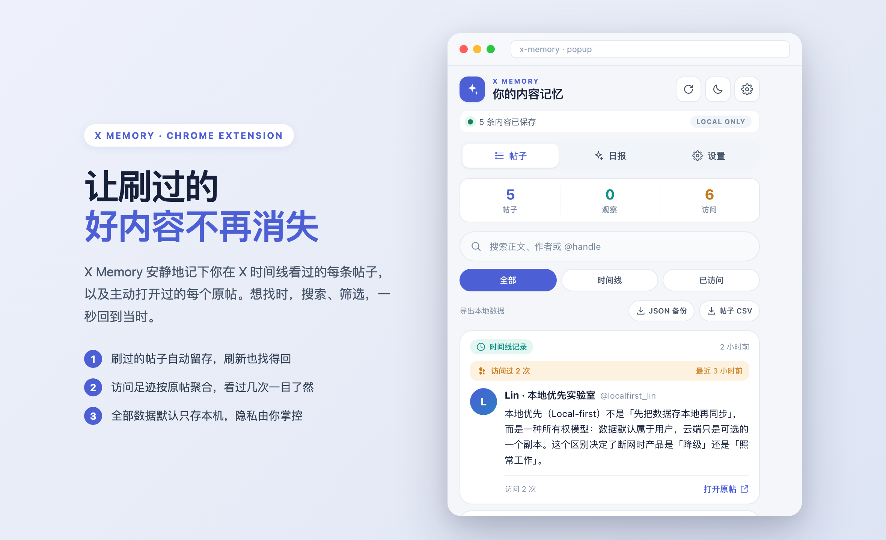
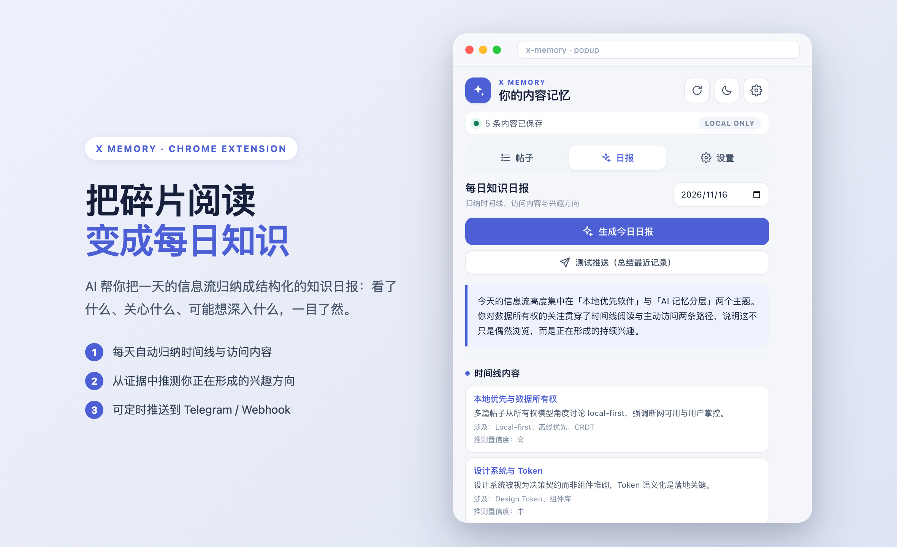
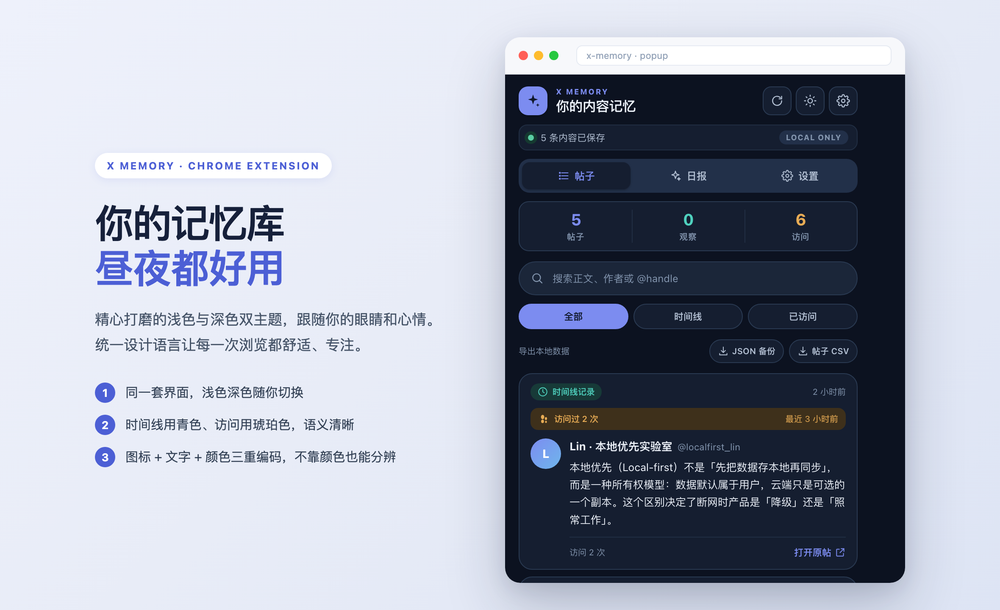
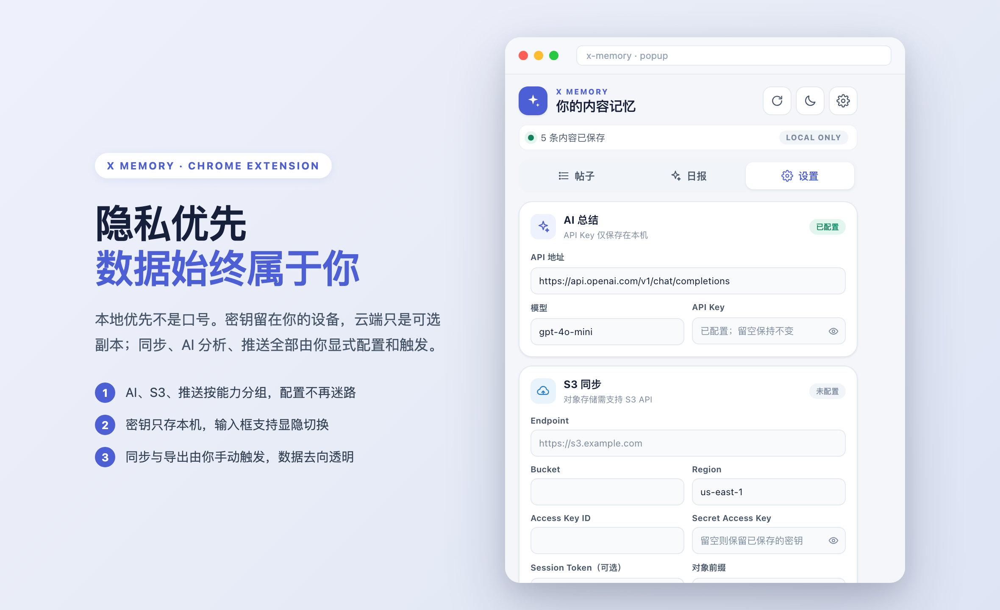

<div align="center">

# ✦ X Memory

### 刷过的内容，从此不再消失

**一个本地优先的 X 内容记忆扩展。** 它安静地记下你在时间线看过的每条帖子、主动打开过的每个原帖，把稍纵即逝的信息流，变成属于你、可搜索、可复盘的个人知识库。



[](manifest.json)
[](test/)
[](#-隐私优先数据只属于你)
[](#)

</div>

---

## 🤔 你有没有遇到过这些时刻？

- 在 X 上刷到一条特别好的帖子，想收藏时已经被新内容冲走了；
- 记得看过某个观点，却怎么也搜不回那条原帖；
- 点开一条转帖后忘了自己之前有没有访问过原始来源；
- 每天看了很多，却说不清自己到底对什么感兴趣。

**X Memory 就是为这些时刻而生的。**

它不打扰你的浏览，只在后台默默把「看过的」和「访问过的」分开记好，需要时一搜即得。

---

## ✨ 核心能力

### 📌 时间线与足迹，各自记录、按帖聚合

时间线里划过的帖子、你主动点开的原帖，是两个独立的数据域。打开一条记录，能看到它是否访问过、访问了几次——转帖和原帖的关系一目了然。


### 🔍 全文搜索 + 智能筛选

按正文、作者、@handle 搜索；用「全部 / 时间线 / 已访问」快速切换。128 条帖子、47 次访问，都能在一秒内定位。

### 🧠 AI 每日知识日报

每天自动把你看过的内容归纳成结构化日报：时间线在关注什么、主动访问了什么、你可能正在形成哪些兴趣方向——并且给出证据和置信度，而不是空泛的总结。



### 📤 定时推送与可控同步

日报可按时推送到 Telegram 或任意 Webhook；需要备份时，手动同步到你自己的 S3 兼容存储。所有外部服务都由你配置、由你触发。

---

## 🌗 精心打磨的双主题

浅色专注、深色护眼，同一套设计语言贯穿始终。时间线用青色、访问用琥珀色，配合图标与文字三重编码——不依赖颜色也能分辨语义。



---

## 🔐 隐私优先，数据只属于你

这不是一句口号，而是产品的设计底线：

- **默认本地**：所有记录只存在你的浏览器本地，不上传任何服务器；
- **密钥不出本机**：AI Key、S3 凭据、Bot Token 只保存在扩展本地存储；
- **外发透明**：只有当你主动配置并触发时，帖子正文才会发送给 AI 服务、同步到 S3 或推送到 Webhook；
- **远端不阻塞本地**：网络失败时本地回看完全不受影响；
- **随时导出**：一键导出完整 JSON 快照或帖子 CSV，数据可随时带走。



---

## 🚀 快速开始

### 安装（无需开发者账号）

```sh
git clone https://github.com/kbsonlong/x-memory.git
cd x-memory
npm run build:chrome
```

把 `build/chrome/unpacked/` 目录作为「已解压的扩展程序」加载：

1. 打开 `chrome://extensions`
2. 开启右上角 **开发者模式**
3. 点击 **加载已解压的扩展程序**，选择 `build/chrome/unpacked/`

> 想上架商店？Edge Add-ons 免费，Chrome Web Store 一次性 $5。完整分发指南见 [docs/10-distribution.md](docs/10-distribution.md)。

### 日常使用

- 照常刷 X，插件自动保存时间线内容；
- 点开原帖，访问足迹会被记录并累加到对应卡片；
- 点击工具栏图标，搜索、筛选、回看你的记忆；
- 在「日报」页生成 AI 知识日报，或在「设置」页配置定时推送。

---

## 🏗️ 它是怎么工作的

X Memory 把「时间线历史」和「访问足迹」建模为两个独立数据域，用 `postId` 作为跨域关联键，通过统一的 Repository 与 Query Service 关联查询。UI 和内容脚本不直接碰存储、AI 或 S3——所有能力收敛到 MV3 service worker 的消息协议里。

```
X 页面 ──采集──> content script ──消息──> service worker
                                              │
                        ┌─────────────────────┼─────────────────────┐
                     Repository          Query Service         AI / Sync
                        │                     │                     │
                  本地存储域           按 postId 跨域关联      可选外发（显式触发）
```

- **本地优先**：远端失败不阻塞本地，语义不依赖单一数据源；
- **幂等迁移**：旧数据结构可重复迁移，不删数据、不覆盖新实体；
- **稳定协议**：为 Agent 读取预留了受授权约束的接口。

---

## 📚 文档

| 文档 | 内容 |
|------|------|
| [产品设计](docs/01-product-design.md) | 定位、用户价值与产品边界 |
| [架构设计](docs/02-architecture.md) | 全局能力与数据域的划分 |
| [领域模型](docs/03-domain-model.md) | 实体、关联键与生命周期 |
| [AI 日报](docs/04-ai.md) | 日报生成与兴趣推测 |
| [同步机制](docs/05-sync.md) | S3 快照同步策略 |
| [UI 设计方案](docs/09-ui-design-system.md) | 设计系统、组件与状态规范 |
| [分发指南](docs/10-distribution.md) | 打包、上架与商店发布 |

---

## 🛠️ 开发验证

```sh
npm test              # 17 项测试
npm run check         # 语法、manifest 与图标校验
npm run build:chrome  # 构建 Chrome/Edge 包
npm run build:extensions  # 构建 Safari 双平台（macOS + iOS，需 macOS + Xcode）
```

### Safari（macOS / iOS）

`npm run build:extensions` 会生成同时包含 iOS 与 macOS 目标的 Safari Web Extension：

| 产物 | 用途 |
|------|------|
| `build/safari/X-Memory.app` | macOS 端 App，双击运行后在 Safari 设置中勾选扩展 |
| `build/safari/X-Memory-macos-safari.zip` | macOS 分发包 |
| `build/safari/X-Memory-ios-simulator.zip` | iOS 模拟器包，可直接拖入模拟器验证 |
| `build/safari/X-Memory-xcode-project.zip` | 含 iOS + macOS 双目标的 Xcode 工程，真机调试用 |

iOS 真机安装：解压 Xcode 工程后用 Xcode 打开，选择自己的开发者身份签名，连接 iPhone 运行即可（免费 Apple ID 也能真机调试）。

---

<div align="center">

**把信息流，变成属于你的记忆。**

Made with local-first principles · 数据始终在你的设备上

</div>
